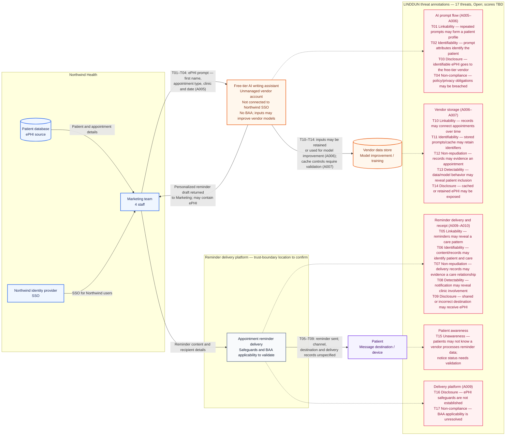

# GRC-Analyst
A fictional GRC case study assessing an AI policy exception request involving patient data at a healthcare SaaS company. It demonstrates evaluating ePHI classification, risk scoring, compliance decisions, and drafting clear stakeholder communication in a regulated environment.

# Overview

𝐍𝐨𝐫𝐭𝐡𝐰𝐢𝐧𝐝 𝐇𝐞𝐚𝐥𝐭𝐡, a 120-person US healthcare SaaS company that stores patient data (ePHI) for around 400 clinics.

As a GRC Analyst, I have received ticker from the line manager:

> "Marketing want an exception to our AI policy. Can you assess it and recommend a decision? Please draft the reply to the Head of Marketing too."
𝐓𝐡𝐞 𝐫𝐞𝐪𝐮𝐞𝐬𝐭 (𝐟𝐫𝐨𝐦 𝐭𝐡𝐞 𝐇𝐞𝐚𝐝 𝐨𝐟 𝐌𝐚𝐫𝐤𝐞𝐭𝐢𝐧𝐠)

> "We'd like to use a free AI writing assistant to personalise appointment reminder messages. The team would paste in the patient's first name, appointment type, clinic, and date. It would save us around 10 hours a week. Can we get an exception?"
𝐍𝐨𝐫𝐭𝐡𝐰𝐢𝐧𝐝 𝐩𝐨𝐥𝐢𝐜𝐲 𝐞𝐱𝐜𝐞𝐫𝐩𝐭

> 𝐀𝐜𝐜𝐞𝐩𝐭𝐚𝐛𝐥𝐞 𝐔𝐬𝐞 𝐏𝐨𝐥𝐢𝐜𝐲, 𝟒.𝟑: ePHI must not be entered into any system that has not been approved by Security and covered by a Business Associate Agreement (BAA) where required.

**What there is to Know about the tool**
- The free tier's terms allow user inputs to be used to improve the vendor's models
- No BAA is available on the free tier
- An enterprise tier exists at $30 per user per month: it includes a BAA, no training on customer data, SSO, and audit logs
- The marketing team has four people

The combination of patient's first name, appointment type, clinic, and date is ePHI. Sections 164.514(b) of the HIPPA privacy rule, otherwise known as the "Safe Harbour" method for de-identification mandates the removal of 18 types of identifiers. The marketing teams exception request inclusion of the patients name strictly violates identifier number 1 (Names) and the inclusion of patients appointment date strictly violates identifier 3 (All elements of dates) of the 18 identifiers laid out by Sections 164.514(b).

**Why I built this:** After reviewing dozens of GRC job descriptions, risk assessments and risk registers were always at the top of the list. I wanted to go beyond resume keywords and show hiring managers audit-ready work that reflects day-one readiness.  See [how this project maps to real job requirements](https://github.com/nickq1986/GRC-Analyst/blob/refine/Job%20Requirements%20Map.md).

# Key Findings 
 

  
| Rating         | Count    | Headline |
|----------------|----------|---------------------------------------------------------------------------------------------------------------------------|
| 🔴Critical     | 1        | Uploading protected patient data to free AI tools causing a major compliance violation.
| 🟠High         | 2        | Storing patient data with outside AI vendors, creating severe, permanent risks of re-identification and improper access.  |  
| 🟡High/Medium  | 3        | Access control issues and Non-compliance cause severe privacy breaches and HIPAA fines.                                   |
  
 # Architecture

# Project Structure

|File                    | What it shows                                            |
|------------------------|----------------------------------------------------------|
|01 [Scope and Context](https://github.com/nickq1986/GRC-Analyst/blob/refine/documents/01-Scope%20and%20Context.md)   |     Defines the organizational context, interested party requirements, and operational boundaries (scope) for Northwind Health’s ISO 27001-compliant Information Security Management System (ISMS).                                                     |
|02 [Asset Register](https://github.com/nickq1986/GRC-Analyst/blob/main/documents/02-Northwinds%20Health_Asset_Register.md)          |  Catalogues organizational assets, owners, trust boundaries, and compliance attributes (ePHI, BAA, SSO) to establish the scope for risk analysis.                                                        | 
|03 [Risk Assessment Methodology](https://github.com/nickq1986/GRC-Analyst/blob/main/documents/02-Northwinds%20Health_Asset_Register.md)        |   Defines the methodology for identifying, scoring, and prioritizing threats and vulnerabilities to ensure consistent risk evaluation.                                                       |
|04 [Data Flow and Threat Model](https://github.com/nickq1986/GRC-Analyst/blob/main/documents/04-Data%20Flow%20and%20Threat%20Model.md)       |   Maps data flows across trust boundaries and systematically identifies LINDDUN privacy threats to highlight system vulnerabilities before risk scoring.                                                       |
|05 [Vulnerability-to-Threat Mapping & Risk Statement Register](https://github.com/nickq1986/GRC-Analyst/blob/main/documents/05-Vulnerability-to-Threat%20Mapping%20%26%20Risk%20Statement%20Register.md)    |                Aggregates granular threats against specific asset vulnerabilities to construct structured risk statements for downstream scoring.                                          |
|06 [Risk Register and Treatment Plan](https://github.com/nickq1986/GRC-Analyst/blob/main/documents/06-Risk%20Register%20and%20Treatment%20Plan.md) |                                                          |Evaluates pre-mitigation risk severity using likelihood and impact scoring, assigning control owners, ISO 27002 mitigation measures, and operational remediation timelines.|

# Frameworks Used
- HIPAA Security Rule: regulatory requirements for ePHI
- ISO/IEC 27001 For Risk Assessment Process
- ISO/IEC 27002 For control mapping

  # What I learned

- Formal Threat Mapping Clarifies Risk: Using LINDDUN to map specific threats against asset vulnerabilities prevented overlap and created distinct, actionable risk statements.

-Compliance Expectations Shape Severity: The presence of ePHI under HIPAA transformed what would be a minor shadow IT concern into a critical regulatory non-compliance issue.

# What I would Improve 

While this assessment effectively resolved the immediate policy exception request, a comprehensive post-assessment review highlights key areas to mature Northwind Health’s GRC operational posture:

* **Formulate a Dedicated AI Governance Policy:** Expand the general Acceptable Use Policy (Section 4.3) into a standalone AI Governance Framework covering generative AI usage, prompt engineering boundaries, model training opt-outs, and shadow AI detection mechanisms.
* **Formalize Quantitative Risk Analysis (FAIR Integration):** Enhance the qualitative $5 \times 5$ ISO 27005 matrix by incorporating quantitative financial loss modeling (Factor Analysis of Information Risk) to provide executive stakeholders with annualized loss expectancy (ALE) projections for regulatory breach scenarios.

# Tools
Markdown, Mermaid, IS0/27001, HIPAA Security Rule

