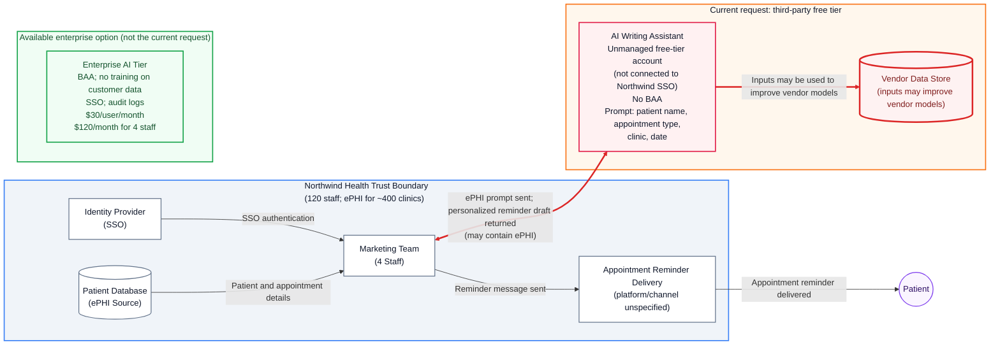

# GRC-Analyst
A fictional GRC case study assessing an AI policy exception request involving patient data at a healthcare SaaS company. It demonstrates evaluating ePHI classification, risk scoring, compliance decisions, and drafting clear stakeholder communication in a regulated environment.

# Overview

𝐍𝐨𝐫𝐭𝐡𝐰𝐢𝐧𝐝 𝐇𝐞𝐚𝐥𝐭𝐡, a 120-person US healthcare SaaS company that stores patient data (ePHI) for around 400 clinics.

As a GRC Analyst, I have received ticker from the line manager:

> "Marketing want an exception to our AI policy. Can you assess it and recommend a decision? Please draft the reply to the Head of Marketing too."
𝐓𝐡𝐞 𝐫𝐞𝐪𝐮𝐞𝐬𝐭 (𝐟𝐫𝐨𝐦 𝐭𝐡𝐞 𝐇𝐞𝐚𝐝 𝐨𝐟 𝐌𝐚𝐫𝐤𝐞𝐭𝐢𝐧𝐠)

> "We'd like to use a free AI writing assistant to personalise appointment reminder messages. The team would paste in the patient's first name, appointment type, clinic, and date. It would save us around 10 hours a week. Can we get an exception?"
𝐍𝐨𝐫𝐭𝐡𝐰𝐢𝐧𝐝 𝐩𝐨𝐥𝐢𝐜𝐲 𝐞𝐱𝐜𝐞𝐫𝐩𝐭

> 𝐀𝐜𝐜𝐞𝐩𝐭𝐚𝐛𝐥𝐞 𝐔𝐬𝐞 𝐏𝐨𝐥𝐢𝐜𝐲, 𝟒.𝟑: ePHI must not be entered into any system that has not been approved by Security and covered by a Business Associate Agreement (BAA) where required.

**What there is to Know about the tool**
- The free tier's terms allow user inputs to be used to improve the vendor's models
- No BAA is available on the free tier
- An enterprise tier exists at $30 per user per month: it includes a BAA, no training on customer data, SSO, and audit logs
- The marketing team has four people

The combination of patient's first name, appointment type, clinic, and date is ePHI. Sections 164.514(b) of the HIPPA privacy rule, otherwise known as the "Safe Harbour" method for de-identification mandates the removal of 18 types of identifiers. The marketing teams exception request inclusion of the patients name strictly violates identifier number 1 (Names) and the inclusion of patients appointment date strictly violates identifier 3 (All elements of dates) of the 18 identifiers laid out by Sections 164.514(b).

# Key Findings 
 

  
| Rating         | Count    | Headline |
|----------------|----------|---------------------------------------------------------------------------------------------------------------------------|
| 🔴Critical     | 1        | Uploading protected patient data to free AI tools causing a major compliance violation.
| 🟠High         | 2        | Storing patient data with outside AI vendors, creating severe, permanent risks of re-identification and improper access.  |  
| 🟡High/Medium  | 3        | Access control issues and Non-compliance cause severe privacy breaches and HIPAA fines.                                   |
  
 # Architecture

# Project Structure

|File                    | What it shows                                            |
|------------------------|----------------------------------------------------------|
|01 [Scope and Context](https://github.com/nickq1986/GRC-Analyst/blob/refine/documents/Scope%20and%20Context.md)   |                                                          |
|02 Methodology          |                                                          | 
|03 Risk Register        |                                                          |
|04 Treatment Plan       |                                                          |
|05 Executive Summary    |                                                          |
|06 Job Requirements Map |                                                          |

# Frameworks Used
- HIPAA Security Rule: regulatory requirements for ePHI
- ISO/IEC 27001 For Risk Assessment Process
- ISO/IEC 27002 For control mapping

# What I would Improve 

# Tools
Markdown, Mermaid, IS0/27001, HIPAA Security Rule

